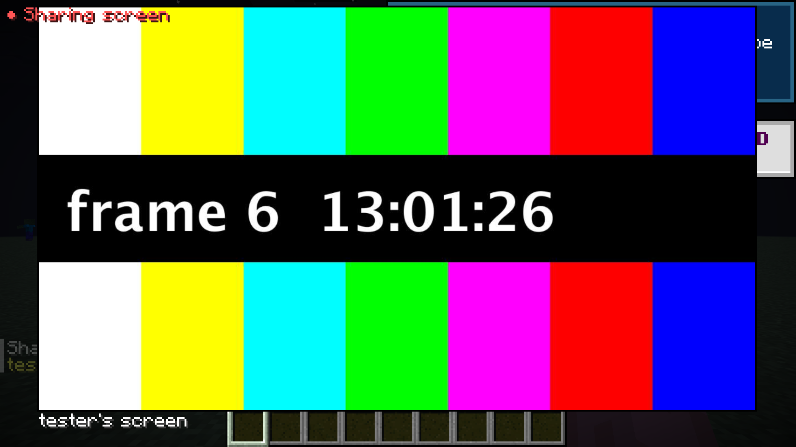

# mc-screenshare

Share your desktop with other players on a Minecraft server.
The sharer presses a key, and anyone who wants to watch sees that screen inside the game.

It has two parts:

| Part | Where it runs | Folder |
|---|---|---|
| Client mod (Fabric) | Every player who shares or watches | `fabric/` |
| Server plugin (Paper) | The server | `paper/` |

Target: Minecraft Java Edition 26.3, Fabric Loader 0.20.1, Fabric API 0.166.2+26.3, Paper 26.3.



## Background

We run a company Minecraft server as a virtual office (Paper 26.3 on AWS, with Simple Voice Chat for voice).
Voice worked, but people also wanted to show each other their screens without leaving the game.

In November 2026 we looked at the existing mods:

| Mod | Why we could not use it |
|---|---|
| StreamCraft Live | Supports 26.3, but must also run on the server as a Fabric mod. Our server runs Paper, and moving it to Fabric would mean rebuilding it, including Bedrock (Geyser) access. |
| SVC Screen Share (Simple Voice Chat addon) | Only released for 26.2. Its license is "All Rights Reserved" and no source is published, so we could not port it to 26.3 ourselves. |

Asking the SVC Screen Share author for a 26.3 build was possible, but there was no sign of an update after September 2026.
So we wrote our own, from scratch.
No code from either mod was used; this project only talks to vanilla Minecraft, Fabric API and the Paper API.

The design aims at "good enough for showing a slide or a terminal", not video:
about one frame per second, JPEG, no audio.

## How it works

1. The sharer's client takes a screenshot with the OS's own tool, because Minecraft runs with `java.awt.headless=true` and `java.awt.Robot` is unavailable.
   - macOS: `screencapture`
   - Windows: one long-running PowerShell process using `System.Drawing`
   - Linux: `grim` (Wayland) or ImageMagick `import` (X11)
2. The image is scaled to at most 1280 px wide and encoded as JPEG.
3. The JPEG is cut into 30,000-byte chunks, because client-to-server custom payloads are capped at 32,767 bytes.
4. The Paper plugin checks each chunk's header and forwards the bytes, unchanged, to every player who asked to watch. It never decodes images.
5. The watcher's client reassembles the newest frame, decodes it on a background thread and draws it on the HUD.

Plugin channels: `screenshare:frame_up`, `screenshare:frame_down`, `screenshare:control`, `screenshare:state`.
The byte layout is documented in `fabric/src/main/java/io/github/tdual/screenshare/net/` and `paper/src/main/java/io/github/tdual/screenshare/paper/Wire.java`.

## Install

### Server

Put `screenshare-paper-<version>.jar` in `plugins/` and restart.
A `plugins/ScreenShare/config.yml` is created:

| Key | Default | Meaning |
|---|---|---|
| `max-sharers` | 3 | How many people may share at the same time |
| `max-kilobytes-per-second` | 600 | Upload limit per sharer; chunks above it are dropped |
| `idle-timeout-seconds` | 10 | A share ends when no frame arrives for this long |

Permissions: `screenshare.share` and `screenshare.watch` (everyone by default), `screenshare.admin` (ops).

### Client

Put these in the `mods` folder of a Fabric 26.3 profile:

- Fabric API
- `screenshare-fabric-<version>.jar`

On macOS, the first share triggers a Screen Recording permission request for the launcher (for example Prism Launcher).
Allow it in System Settings → Privacy & Security → Screen Recording, then restart the game.
Without it, macOS returns only the wallpaper.

## Usage

| Action | How |
|---|---|
| Start or stop sharing your screen | `J` |
| Show shared screen: off → small (top right) → large (center) → off | `K` |
| Watch a specific person | `/ss watch <name>` |
| Stop watching | `/ss off` |
| Reload client settings | `/ss reload` |
| List who is sharing (server command) | `/screenshare` |
| Stop someone's share (ops) | `/screenshare stop <name>` |

Keys can be changed under Options → Controls → Key Binds → Screen Share.

The whole monitor is shared, including notifications and other windows. Close anything private before pressing `J`.

Client settings live in `config/screenshare.properties`:

| Key | Default | Range |
|---|---|---|
| `fps` | 1.0 | 0.2 – 5 |
| `max_width` | 1280 | 320 – 1920 |
| `jpeg_quality` | 0.6 | 0.1 – 1.0 |
| `display` | 1 | monitor number |

## Bandwidth and cost

Each frame is sent once by the sharer and once to every watcher.
A 1280 px desktop at quality 0.6 is roughly 80–150 KB, so at 1 fps each watcher costs about 0.3–0.5 GB per hour of server egress.
On AWS (about $0.114/GB out of Tokyo) that is around $0.05 per watcher-hour. Raise `fps` with care.

## Status

| Item | State |
|---|---|
| Send → relay → receive → draw | Tested on macOS with a local Paper 26.3 server and a generated test pattern (screenshot above) |
| Paper plugin logic | 9 unit tests (`paper/src/test`) |
| Real desktop capture on macOS | Not yet tested (the development terminal lacked Screen Recording permission) |
| Windows and Linux capture | Not yet tested |
| Two different players on the real server | Not yet tested |

## Development

Requires Java 25. Gradle uses an installed JDK 25 if it finds one and otherwise downloads it (`gradle/gradle-daemon-jvm.properties`), so `./gradlew` works even when the default `java` is older.

```bash
cd fabric && ./gradlew build   # fabric/build/libs/screenshare-fabric-<version>.jar
cd paper  && ./gradlew build   # paper/build/libs/screenshare-paper-<version>.jar (runs the unit tests)
```

GitHub Actions builds both on every pull request and push to `main`.
Publishing a GitHub release tagged `v<version>` attaches both jars to it; the tag must match `version` in `fabric/gradle.properties` and `paper/build.gradle`.

Self-test: start a Paper 26.3 server on `127.0.0.1:25566` with `online-mode=false`, `difficulty=peaceful`, whitelist off and the plugin installed, then run `cd fabric && ./gradlew runClient`.
The dev run joins that server, shares a generated test pattern (`-Dscreenshare.testpattern=true`), watches itself (`-Dscreenshare.selftest=true`), saves a screenshot under `fabric/run/screenshots/` after five frames and quits.

## License

MIT
